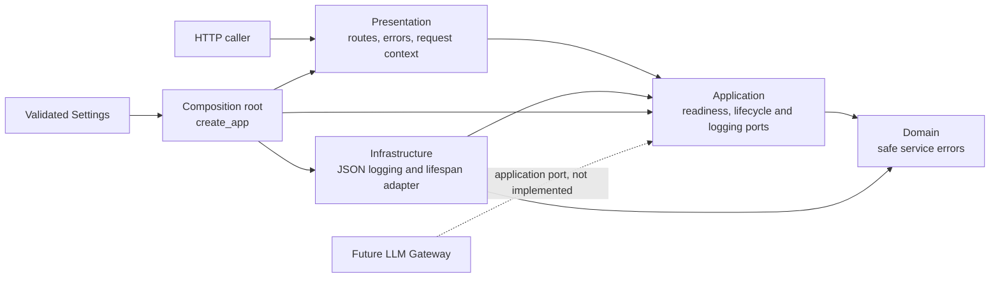

# AI service internal architecture

## Implemented boundary

Checkpoint 2.2 structures the FastAPI process without adding inference. The composition root is
`mm_ai_service.main:create_app`; it creates an independent application instance from validated
settings, an event-logging port, and an optional sequence of resources actually used by that
instance. There is no module-level FastAPI application or mutable settings singleton.

## Layer responsibilities

- `domain`: framework-independent error taxonomy. It imports no FastAPI, application,
  infrastructure, or presentation code.
- `application`: model-neutral readiness behavior and small ports for managed resources and event
  logging. It imports no FastAPI or outer layer.
- `infrastructure`: concrete JSON logger and FastAPI lifespan adapter. It may depend inward on
  application/domain contracts and never on presentation.
- `presentation`: HTTP routes, error mapping, request-ID context, and ASGI middleware. It depends on
  application/domain contracts; technical implementations arrive through constructor arguments.
- `main.py`: the only composition root. It loads configuration only when no explicit settings are
  supplied and connects all adapters without a dependency-injection framework.

Architecture tests parse Python imports and enforce the meaningful inward dependency restrictions.

## Configuration

`Settings` is validated and frozen. Default source precedence is explicit constructor values,
process environment, the service `.env` file, then declared defaults. Variables use the
`AI_SERVICE_` prefix. Only environment, host, port, and log level exist because they are consumed by
the current process. No Ollama, model, generation, or concurrency setting is introduced early.

The application factory has no network calls, client construction, model loading, or other hidden
side effects. Uvicorn starts it with `--factory` semantics through `python -m mm_ai_service`.

## Operational contracts

- `GET /health` means the HTTP process is alive.
- `GET /ready` means implemented application configuration is ready.
- Readiness reports `configuration: true`, `ollama: false`, and `inference: false`.
- Neither endpoint contacts Ollama or any external service.

The future LLM Gateway belongs behind an application-layer port. Provider-specific transports,
models, and exceptions must remain infrastructure adapters and are not part of this checkpoint.
