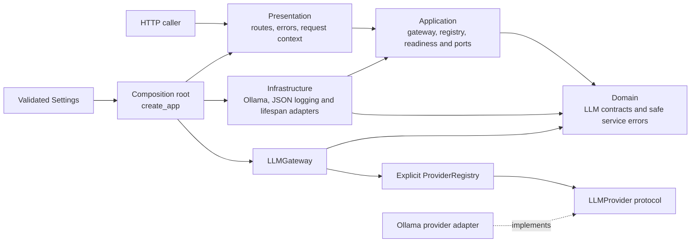

# AI service internal architecture

## Implemented boundary

Checkpoint 2.2 structures the FastAPI process, Checkpoint 2.3 adds the model-neutral gateway, and
Checkpoint 2.4 adds a concrete lifecycle-managed Ollama infrastructure adapter. The composition root is
`mm_ai_service.main:create_app`; it creates an independent application instance from validated
settings, an event-logging port, and an optional sequence of resources actually used by that
instance. There is no module-level FastAPI application or mutable settings singleton.

## Layer responsibilities

- `domain`: immutable provider-neutral completion/streaming contracts and framework-independent
  error taxonomy. It imports no FastAPI, application, infrastructure, or presentation code.
- `application`: the model-neutral gateway, explicit provider registry/protocol, readiness behavior,
  and small ports for managed resources and event logging. It imports no FastAPI or outer layer.
- `infrastructure`: concrete Ollama provider, JSON logger, and FastAPI lifespan adapter. It may
  depend inward on application/domain contracts and never on presentation.
- `presentation`: HTTP routes, error mapping, request-ID context, and ASGI middleware. It depends on
  application/domain contracts; technical implementations arrive through constructor arguments.
- `main.py`: the only composition root. It loads configuration only when no explicit settings are
  supplied and connects all adapters without a dependency-injection framework.

Architecture tests parse Python imports and enforce the meaningful inward dependency restrictions.

## Configuration

`Settings` is validated and frozen. Default source precedence is explicit constructor values,
process environment, the service `.env` file, then declared defaults. Variables use the
`AI_SERVICE_` prefix. Gateway configuration covers the optional provider identifier, concurrency,
end-to-end timeout, provider-neutral generation defaults, and a validated Ollama origin/model. The
Ollama origin defaults to loopback and accepts private IPs only through an explicit production policy.

The application factory has no network calls, client construction, model loading, or other hidden
side effects. Uvicorn starts it with `--factory` semantics through `python -m mm_ai_service`.

## Operational contracts

- `GET /health` means the HTTP process is alive.
- `GET /ready` means implemented application configuration is ready.
- With Ollama unselected, readiness reports provider, model, and inference false. When selected, a
  bounded cached probe checks version, inventory, and model details without inference.
- `/health` never contacts Ollama. No endpoint contacts an external AI service.

The model-neutral LLM Gateway remains in the application layer. Ollama HTTP schemas, endpoint policy,
and exception translation stay inside its infrastructure adapter.
