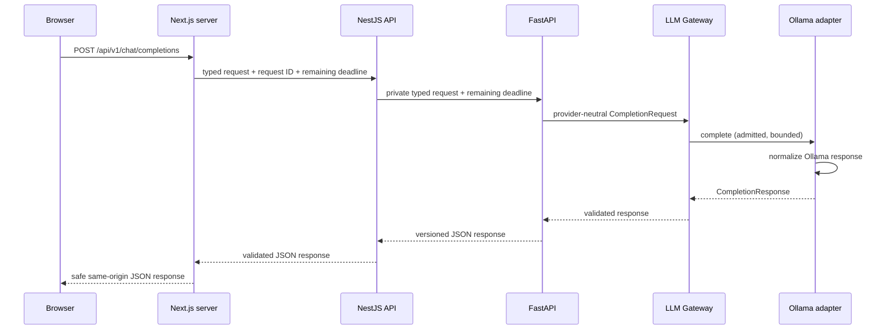

# Chat completion API

## Boundary and endpoints

Checkpoint 2.5 preserves the approved path:

```text
Browser → Next.js Route Handler → NestJS business API → FastAPI AI service
        → LLM Gateway → configured provider adapter → local model
```

The browser-facing endpoints are the same-origin Next.js routes:

- `POST /api/v1/chat/completions`
- `POST /api/v1/chat/completions/stream`

NestJS owns the same versioned business paths. FastAPI exposes private loopback-only internal paths
`/v1/chat/completions` and `/v1/chat/completions/stream`. Browser code never receives the NestJS,
FastAPI, or Ollama origin. `API_BASE_URL`, `AI_SERVICE_BASE_URL`, and the provider URL are server-only
configuration.



## Request contract version 1

```json
{
  "version": "1",
  "messages": [{ "role": "user", "content": "Xin chào" }],
  "generation": { "temperature": 0.2, "max_output_tokens": 256 },
  "thinking": { "mode": "disabled" }
}
```

Only alternating `user` and `assistant` history is accepted, beginning and ending with `user`.
Public callers cannot inject `system` or `tool` roles, select a model/provider, specify an upstream
URL, pass provider options, or override context. Unknown fields are rejected at NestJS and FastAPI.

Limits are enforced at multiple boundaries:

| Limit              |            Value |
| ------------------ | ---------------: |
| JSON body          |     65,536 bytes |
| Messages           |               16 |
| Individual message | 2,048 characters |
| Aggregate input    | 3,072 characters |
| Output             |     1,024 tokens |
| Configured context |     4,096 tokens |

FastAPI conservatively requires aggregate input characters plus output tokens to remain within the
configured context budget. Temperature is finite and between 0 and 2. Thinking is explicitly
`disabled` or `enabled`; disabled is the public default.

## Response contract version 1

```json
{
  "version": "1",
  "request_id": "request-123",
  "model": "qwen3.5:35b",
  "message": { "role": "assistant", "content": "Chào bạn" },
  "finish_reason": "stop",
  "usage": {
    "prompt_tokens": 7,
    "completion_tokens": 3,
    "total_tokens": 10
  }
}
```

The model value is the approved server configuration, never a client selection. No provider payload,
reasoning field, infrastructure URL, exception text, or unrestricted metadata crosses the transport.

## Error mapping

FastAPI retains the stable `{error: {code, message, request_id}}` contract. NestJS and Next.js do not
forward raw upstream error bodies and use generic safe proxy errors. Important statuses are 400 for
invalid contracts, 413 for body size, 415 for media type, 422 for unsupported model capability, 503
for provider/admission availability, 504 for timeout categories, and 502 for malformed upstream
responses. Correlation is returned in `X-Request-ID` at every boundary.

## Security status

All four local services bind to loopback and private origins are allowlisted by configuration.
Authentication and RBAC are not implemented. Therefore these endpoints are approved only for local
development verification. A production deployment must add authenticated authorization at the
business API and web boundary before exposing chat routes.
