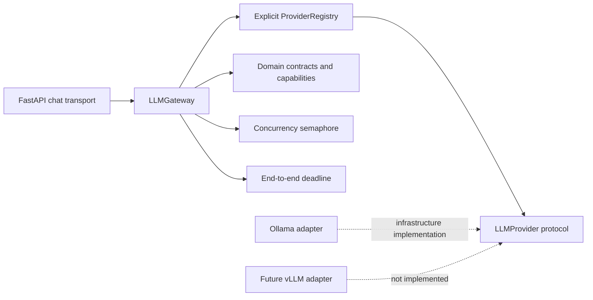

# Model-neutral LLM Gateway

## Implemented boundary

Checkpoint 2.3 implements the in-process application service. Checkpoint 2.4 supplies an Ollama
infrastructure adapter, and Checkpoint 2.5 adds a thin versioned HTTP/SSE transport while retaining
the same provider-neutral gateway.

## Request flow

1. Resolve exactly the configured provider identifier. There is no automatic discovery or fallback.
2. Validate chat, thinking, streaming, and context capabilities before entering provider capacity.
3. Merge caller options with explicit defaults: temperature `0.2`, maximum output tokens `1024`, and
   context window `4096` unless configured otherwise.
4. Apply bounded admission, first-content, inactivity, and total deadlines around provider work.
5. Acquire bounded capacity. The local-inference target is one active and one pending request.
6. Call the asynchronous provider contract and validate its provider-neutral response or stream.

No retry occurs. Unknown or absent providers report unavailability and never fall back to an external
service.

## Timeout, concurrency, and cancellation

The admission controller defaults to one active and one pending request. Admission, first-content,
stream-inactivity, and total request timeouts are independently bounded. The incoming remaining
deadline is clamped to the service policy, so a downstream service cannot extend the caller's budget.
A queued request therefore cannot wait indefinitely. `deadline_seconds(timeout)` exposes the validated,
capped total so services that prepare work first can start their clock before that work and pass only the
remainder (see `context-management.md`).

Context managers release capacity after success, normalized failure, timeout, or cancellation.
External `asyncio.CancelledError` is logged only as a safe event and re-raised unchanged. It is not
converted into an internal failure. Providers must propagate cancellation and clean up their own
transport. Gateway code never silently retries.

## Thinking

`ThinkingConfiguration` has `default`, `enabled`, and `disabled` modes. Enabled mode requires the
provider's thinking capability. Default and disabled modes do not assume thinking support. The
contract contains no Qwen parameter and carries no reasoning trace. Provider-specific translation is
deferred to a future adapter.

## Streaming

The gateway exposes an internal async iterator with typed events: `StreamStarted`, `ContentDelta`,
`UsageUpdate`, `CompletionFinished`, and `StreamError`. A stream must start with `StreamStarted`, end
with a terminal finished/error event, match the requested model identifier, and contain only known
event types. Events are yielded as received without buffering or splitting a completed response.

Consumers must iterate or close/cancel the async generator. Cancellation closes the provider iterator
and releases capacity. Checkpoint 2.5 maps these typed events to a versioned SSE contract without
exposing provider-specific frames or reasoning traces.

## Runtime readiness

`/health` remains process liveness and never contacts Ollama. `/ready` reports separate provider,
model, and inference-compatible states from the selected adapter. Ollama probes are bounded and
cached, use only version/inventory/model-metadata APIs, and never generate text or load a model.
