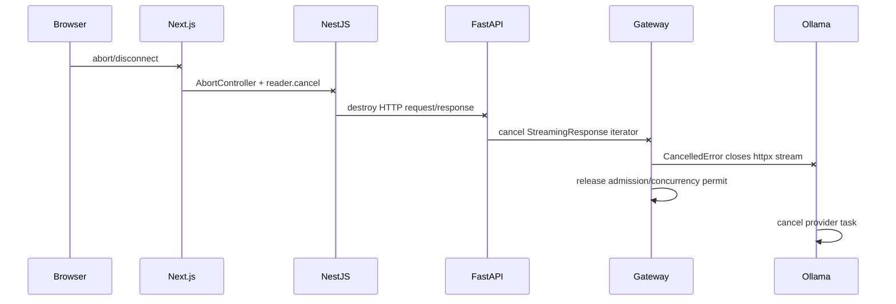
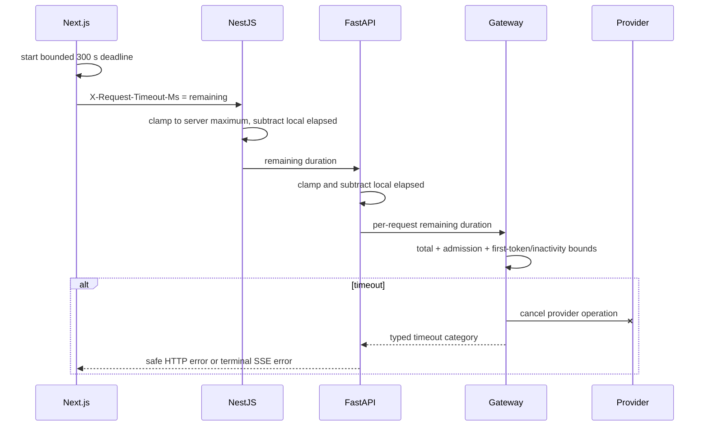

# Request cancellation and deadlines

## Cancellation propagation

Next.js links the browser request signal to its upstream fetch and cancels the source reader when the
browser cancels the response stream. NestJS listens for request abort and response close, destroys the
private upstream response, removes listeners, and does not retry. FastAPI closes the gateway async
generator in `finally`. Gateway cancellation propagates unchanged and the admission controller
releases active or queued slots.

No layer converts every client disconnect into HTTP 500, automatically reconnects, or replays an
inference request. A disconnected transport cannot receive a terminal SSE event.

## Deadline propagation

Client headers can never extend a server deadline. Next.js overwrites browser deadline input with its
server configuration. NestJS and FastAPI clamp received values to their own maximum and subtract
local elapsed time; no hop resets the full budget.

| Timeout                            |     Default |
| ---------------------------------- | ----------: |
| NestJS → FastAPI connect           |   5 seconds |
| Admission waiting                  |  30 seconds |
| First content token                | 240 seconds |
| In-stream inactivity after content |  30 seconds |
| End-to-end request                 | 300 seconds |
| Ollama HTTP read                   | 300 seconds |

The gateway permits one active and one pending operation. A third operation is rejected immediately
as overload. A queued operation that waits longer than 30 seconds gets `ADMISSION_TIMEOUT`. The
single-process controller is not a distributed admission system; multiple AI-service replicas would
each enforce their own local limit.

The application does not warm the model during startup or readiness. Provider reachable, model
available, contract-compatible inference, and model currently loaded remain distinct states.
