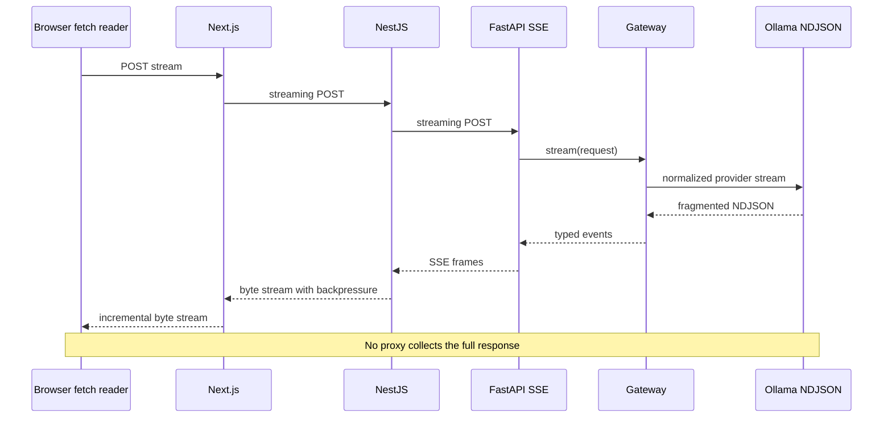

# SSE streaming protocol

## Protocol

The browser uses `fetch()` with POST; `EventSource` is not used because it cannot express the typed
POST body or the required cancellation/deadline policy. Responses use UTF-8
`text/event-stream`, `Cache-Control: no-cache, no-store, must-revalidate`, and
`X-Accel-Buffering: no`.

Every frame is:

```text
event: <event-name>
data: <one compact JSON object>

```

| Event              | Payload fields                                     |
| ------------------ | -------------------------------------------------- |
| `stream.started`   | `version`, `request_id`, `model`                   |
| `content.delta`    | `version`, `request_id`, `content`                 |
| `usage.updated`    | `version`, `request_id`, `usage`                   |
| `stream.completed` | `version`, `request_id`, `finish_reason`, `usage`  |
| `stream.error`     | `version`, `request_id`, safe `error.code/message` |

JSON is serialized with UTF-8 characters intact. Content is never fabricated, coalesced into a full
response, or replayed. Reasoning fields are discarded in the Ollama adapter before an event exists.

## Ordering invariants

1. `stream.started` is first.
2. Zero or more content/usage events follow.
3. Exactly one `stream.completed` or `stream.error` is emitted while the connection remains usable.
4. No event follows a terminal event.
5. Missing starts, duplicate starts, post-terminal events, malformed provider payloads, and incomplete
   upstream streams are rejected.

Errors before the first normalized event remain normal HTTP errors. Errors after headers become one
safe `stream.error`. If the transport itself is disconnected, no terminal event can be delivered;
the chain cancels upstream work instead.



## Fragmentation and backpressure

Ollama NDJSON is decoded line-by-line by httpx, so arbitrary network fragmentation is handled below
the JSON mapper. NestJS forwards Node response chunks and awaits `drain` when its downstream buffer is
full. Next.js exposes a pull-driven `ReadableStream`; cancellation calls `reader.cancel()` and aborts
the upstream fetch. No unbounded event queue exists.

Heartbeat events are not implemented. The first-token timeout is 240 seconds to accommodate the
observed 177-second cold load, stream inactivity is 30 seconds after content begins, and the total
deadline is 300 seconds. Adding heartbeat comments later would require proxy/load-balancer evidence;
it must not disguise a stalled provider or reset inference deadlines.
